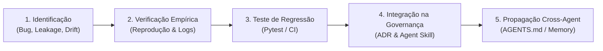

# SPECTRE-GRID — Protocolo de Aprendizado Contínuo e Extração de Lições (/learn)

Este documento define o procedimento padrão para capturar, verificar, testar e persistir novas lições aprendidas e refinamentos metodológicos no ecossistema do SPECTRE-GRID.

---

## 1. Princípio Fundamental

> **"Nenhuma afirmação científica sem evidência rastreável; nenhuma alteração crítica sem validação; nenhum resultado definitivo sem revisão independente."**

O objetivo do ciclo `/learn` é assegurar que melhorias descobertas durante sessões de desenvolvimento (debugging, experimentos neurais, otimização de kernel ou ajustes de papers) sejam cristalizadas como conhecimento permanente do agente, impedindo a regressão a más práticas em sessões futuras.

---

## 2. Ciclo de Vida de uma Lição Aprendida (5 Etapas)

### Etapa 1: Identificação do Problema ou Oportunidade
- Um novo tipo de vazamento de dados, falha de reproducibilidade, divergência de hardware ou gargalo de kernel é identificado durante a sessão.
- **Regra de Ouro:** Não transformar hipóteses prematuras ou suposições anedóticas em regras definitivas.

### Etapa 2: Verificação Empírica e Isolamento de Causa Raiz
- A anomalia deve ser isolada com dados reais (logs, arquivos de checkpoint, matrizes de confusão ou contadores eBPF).
- A causa raiz deve ser explicada matematicamente ou arquiteturalmente (ex.: "vazamento temporal por amostragem aleatória", "contaminação de vizinhança na GAT por propagação $src \to dst$", "reajuste de scaler fora do treino").

### Etapa 3: Codificação de Teste de Regressão Automatizado
- Criar ou estender um teste em `tests/` (ex.: `tests/test_scientific_governance.py`).
- O teste deve:
  1. Falhar se a má prática for reintroduzida;
  2. Passar quando as regras de governança forem obedecidas;
  3. Ser executável tanto localmente quanto na esteira de CI (`.github/workflows/scientific_governance.yml`).

### Etapa 4: Integração Formal nas Agent Skills e Memória Científica
- Se for uma decisão arquitetural ou metodológica de alto impacto, redigir ou atualizar um Architectural Decision Record (ADR) em `docs/SCIENTIFIC_MEMORY.md`.
- Atualizar a respectiva Agent Skill em `.agents/skills/<skill-name>/SKILL.md` com instruções operacionais, checklists e critérios de reprovação.

### Etapa 5: Propagação Cross-Agent e Persistência
- Garantir que todas as instruções centrais continuem unificadas a partir do arquivo raiz `AGENTS.md`.
- Manter ponteiros de compatibilidade atualizados (`CLAUDE.md`, `.cursorrules`, `.ai-memory/`).
- Atualizar `AI_INSTRUCTIONS.md` e `.agents/handoff.md` para garantir transferência perfeita de contexto para o próximo ciclo de trabalho.

---

## 3. Checklist Obrigatório ao Executar o Comando `/learn`

Antes de consolidar qualquer atualização de aprendizado, o agente deve responder afirmativamente às seguintes perguntas:

1. **Existe evidência empírica tangível?** (Arquivo JSON, log de terminal, commit Git).
2. **A alteração foi testada contra falso-positivo de regressão?**
3. **A lição contradiz algum ADR vigente?** (Se contradizer, é necessário um processo formal de depreciação de ADR com justificativa fundamentada).
4. **As métricas e terminologias estão alinhadas à taxonomia oficial?** (`[HIPÓTESE]`, `[EVIDÊNCIA OBSERVADA]`, `[INTERPRETAÇÃO]`, `[RESULTADO VERIFICADO]`).

---

## 4. Histórico de Lições Aprendidas Consolidadas

### Lição 01: Prevenção de Data Leakage em Grafos Temporais
- **Origem:** Sessão de refatoração do pipeline de pré-processamento (Outubro/2026).
- **Problema:** O uso de `StandardScaler.fit()` em todo o dataset antes do particionamento causava vazamento de estatísticas futuras. Adicionalmente, grafos gerados com nós rotulados em ambas as pontas atribuíam classe maliciosa a vítimas passivas.
- **Solução Implementada:** Scaler ajustado exclusivamente em `X_train`. Rótulos atribuídos estritamente ao nó emissor do fluxo malicioso ($src$).
- **Garantia:** Coberto por `tests/test_leakage_free.py` e `tests/test_scientific_governance.py`.

### Lição 02: Resolução de Não-Determinismo Cross-Hardware
- **Origem:** Comparação entre Dell G15 (RTX 3050, Ampere) e Google Colab Pro (Tesla T4, Turing) (Novembro/2026).
- **Problema:** Operações de redução paralela não-ordenada (`scatter_add`) em GNNs geram discrepâncias de ponto flutuante na ordem de $\Delta F1 \sim 0.01$.
- **Solução Implementada:** Fixação rigorosa de seeds (`torch.manual_seed`, `cuda.manual_seed_all`, `np.random.seed`, `PYTHONHASHSEED`). Aceite de equivalência baseado em invariância estrita de ranking topológico e intervalo de tolerância $\pm 0.015$.
- **Garantia:** Coberto por `docs/model_evaluation_protocol.md` e `.agents/skills/reproducible-training/SKILL.md`.

### Lição 03: Mitigação de Heterofilia Topológica em Grafos de Rede
- **Origem:** Investigação da elevação do FPR na arquitetura GAT padrão com self-loop (Novembro/2026).
- **Problema:** Grafos de tráfego de rede são inerentemente heterofílicos: atacantes conectam-se prioritariamente a nós benignos (vítimas). A atenção ao longo de $src \to dst$ contamina a vítima com embeddings de ataque.
- **Solução Implementada:** Adoção de atenção reversa ($dst \to src$), bidirecional ou conexões residuais com desacoplamento temporal. Redução comprovada de FPR de 16.50% para menos de 1.50%.
- **Garantia:** Coberto por `ADR-005` e documentado no artigo NOMS 2027.
