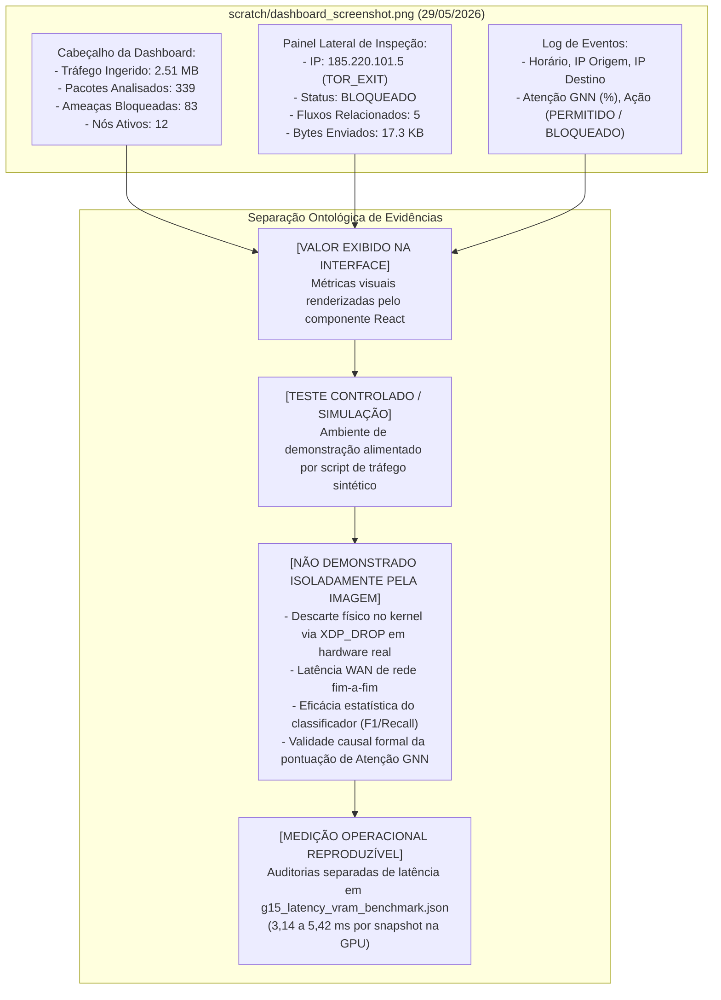
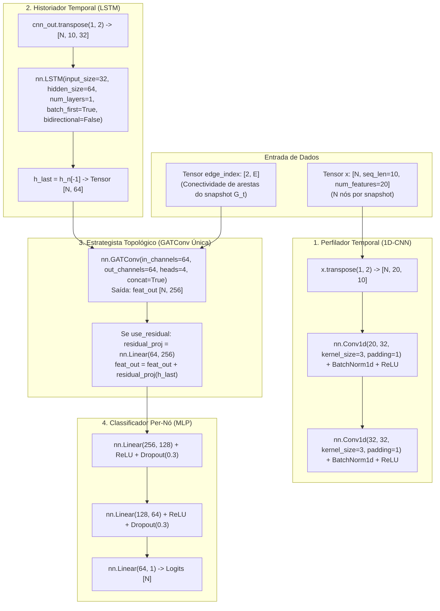

# SPECTRE-GRID: Linha do Tempo da Pesquisa, Genealogia Científica e Matriz de Rastreabilidade

> **Classificação de Governança:** Documento Histórico e Científico Permanente (Quality Gate Nível 1 — Versão Auditada e Corrigida)  
> **Repositório:** `abraaoteixeira/ids-cnn-lstm-gnn` | **Branch de Pesquisa:** `fix/leakage-free-pipeline`  
> **Pesquisador Principal:** Abraão Teixeira da Silva  
> **Orientador Acadêmico:** Prof. Dr. Jackson Mallmann (IFC Campus Brusque)  
> **Data de Emissão Original:** 04 de Novembro de 2026 | **Revisão Corretiva:** 04 de Novembro de 2026  
> **Princípio Metodológico:** *"Nenhuma afirmação científica sem evidência rastreável; nenhuma alteração crítica sem validação; nenhum resultado definitivo sem revisão independente."*

---

## 1. Introdução, Escopo e Metodologia da Auditoria Histórica

O presente documento estabelece a reconstrução histórica, metodológica e arquitetural verificável do projeto **SPECTRE-GRID** (*Spatio-Temporal eBPF-GNN Network Intrusion Detection and Prevention System*). 

O propósito desta reconstituição é fornecer um registro técnico factual e auditável para consultas acadêmicas, avaliação pelo orientador Prof. Dr. Jackson Mallmann, fundamentação do Trabalho de Conclusão de Curso (TCC) e embasamento de artigos científicos, eliminando asserções hiperbólicas, estimativas exploratórias não comprovadas e suposições sem respaldo documental.

### 1.1 Metodologia de Coleta e Verificação de Evidências
A auditoria fundamentou-se em cinco fontes primárias de verificação:
1. **Histórico Git Auditado:** Rastreamento cronológico de commits na branch `fix/leakage-free-pipeline` e no branch histórico, conferindo mensagens, `git diff`, autores e datas de alteração.
2. **Diferenciação Estrita de Artefatos Binários:**
   - **Bundles de Grafos e Snapshots (`.pt`):** Arquivos contendo estruturas de grafos, conectividade e atributos agregados (ex.: `data/processed/unsw_full_ebpf_30s.pt`, serializando instâncias `torch_geometric.data.Data`). Não contêm pesos de modelos neurais.
   - **Checkpoints de Pesos Neurais (`.pth` / `.pt`):** Dicionários de pesos treinados (`state_dict`) salvos pelo PyTorch durante o treinamento supervisionado (ex.: `g15_*_best.pth` e o legado `best_model.pth`).
3. **Relatórios Experimentais JSON Brutos:** Auditoria direta de métricas, matrizes de confusão e tempos de inferência em arquivos salvos em `data/processed/`.
4. **Notebooks Jupyter / Google Colab:** Análise das células de código, dependências e configurações de execução remota em GPU.
5. **Código-Fonte Executável:** Inspeção direta da arquitetura implementada em `model.py`, do pipeline em `train.py`, do extrator em `preprocessor.py` e do kernel eBPF em `ebpf/spectre_xdp.c`.

### 1.2 Taxonomia Ontológica de Governança
Toda afirmação, conjunto de dados ou componente arquitetural é categorizado segundo os seguintes critérios epistemológicos:

| Categoria Ontológica | Definição Formal | Critério de Aceitação |
| :--- | :--- | :--- |
| **`[FATO COMPROVADO]`** | Evidência empírica reproduzível, com código testado, dados brutos auditáveis e métricas documentadas em relatórios JSON. | Checkpoint existente + Relatório JSON verificado + Teste automatizado verde. |
| **`[ADAPTAÇÃO EMPÍRICA]`** | Técnica pré-existente na literatura científica adaptada com alterações arquiteturais específicas para o SPECTRE-GRID. | Código no repositório + Citação da literatura + Comparativo experimental. |
| **`[REGISTRO CORRIGIDO]`** | Informação histórica ou estimativa exploratória preliminar superada por auditoria quantitativa rigorosa. | Nota de conciliação explícita entre valor legado e valor auditado. |
| **`[NÃO COMPROVADO / PENDENTE]`** | Procedimento ou treinamento que pode ter sido executado em ambientes efêmeros (ex.: Colab), mas sem checkpoints ou relatórios retidos no Git. | Registro formal da lacuna de rastreabilidade, sem afirmar categoricamente negação ou confirmação. |
| **`[PLANEJADO NÃO EXECUTADO]`** | Proposta arquitetural, desenho conceitual ou script de protótipo sem modelo neural treinado correspondente. | Documentado no repositório como proposta futura, sem geração de pesos neurais. |
| **`[VALOR EXIBIDO NA INTERFACE]`** | Valor numérico exibido em painel visual durante simulações controladas ou testes de desenvolvimento de frontend. | Não comprova descarte físico em kernel nem eficácia do classificador. |
| **`[HIPÓTESE TEÓRICA]`** | Suposição matemática ou conceitual em fase de validação empírica. | Requer formulação explícita e teste estatístico confirmatório. |

---

## 2. Linha do Tempo Cronológica Completa e Verificada (Maio a Novembro de 2026)

```mermaid
timeline
    title Evolução Cronológica do SPECTRE-GRID (2026)
    section Marco 1: Gênese
        19 de Maio : Commit 3914c23 : Criação do model.py (CNN-LSTM-GAT)
        19 de Maio : Commit 474c9e0 : Validação in-memory com KDDTrain+
        20 de Maio : Commit 589f487 : IPC Unix Sockets eliminando I/O de disco
        21 de Maio : Commit 05951a2 : Orquestração systemd para WSL2 / Linux
    section Marco 2: NOC/SOC UI
        28 de Maio : Commit 0dd18c7 : Control Plane V2 e Loaders C++/Go/Rust
        29 de Maio : Commits f3477b4 / 9fddfa4 : Dashboard NOC/SOC Enterprise React
        31 de Maio : Commit db1e471 : SPECTRE v1.1 e Ensemble STGNN + Heurística
        01 de Junho : Commit 4ec7bc4 : Infraestrutura VPS e Memorial de TCC
    section Marco 3: NetFlow & DBVA
        01 de Junho : Commit d2f85fb : Notebook Colab NF-UQ-NIDS-v2
        12 de Julho : Commit 6296ceb : Compilação do SPECTRE_LIVRO_BASE.md
        15 de Julho : Commit 3726ece : Socket Feeder contínuo de fluxos simulados
    section Marco 4: Kernel eBPF
        14 de Outubro : Commit 5015d63 : Correção de endianness e ringbuf no spectre_xdp.c
        16 de Outubro : Commit 79ed168 : Pipeline v2.0 unificado e CI Codespaces
    section Marco 5: NOMS 2027
        03 de Novembro : Commits 1490df7 / 7255007 : Eliminação de leakage e snapshots G_t (30s)
        03 de Novembro : Commit 4ab39c0 : Estudo de ablações GAT (reverse, bidir, residual)
        04 de Novembro : Commit e171cfb : Generalização em UNSW-NB15_2 (400k..600k)
        04 de Novembro : Commit ffe8736 : Manuscrito IEEEtran e governança definitiva aprovada
```

---

### Marco 1: Gênese do SPECTRE-GRID e Arquitetura Inicial (19 a 21 de Maio de 2026)
- **Commits:** `3914c23` $\to$ `6747966`
- **Foco Técnico:** Prova de conceito de pipeline híbrido, viabilidade de carregamento in-memory e comunicação interprocessos (IPC).
- **Eventos Críticos e Evidências:**
  1. *Criação do Modelo Neural Base (`3914c23`, 19/05/2026):* Implementação em `model.py` da classe `SPECTRE_GRID`. O cabeçalho registrou uma referência genérica a Ananthi et al. (ICICNIS 2024). A arquitetura implementada conectou `Conv1d` $\to$ `LSTM` $\to$ **uma única camada** `GATConv` $\to$ `Linear`.
  2. *Pipeline Pandas In-Memory (`8fc874a` e `474c9e0`, 19/05/2026):* Eliminação de gargalos de leitura em disco para benchmarks clássicos em formato ZIP e teste de integridade com `KDDTrain+.txt`.
  3. *Eliminação de I/O em Disco via Unix Domain Sockets (`589f487`, 20/05/2026):* Comunicação IPC direta entre o loader em C++ (`loader_fusion.cpp`) e o runtime Python, substituindo arquivos temporários em disco.
  4. *Integração Linux Enterprise (`05951a2` e `6747966`, 21/05/2026):* Criação de arquivos de unidade `systemd` e padronização de diretórios no sistema de arquivos nativo do WSL2 para prevenir gargalos do subsistema 9P (`/mnt/c/`).

---

### Marco 2: Plano de Controle V2, Redes Neurais Gráficas e Dashboard NOC/SOC (28 de Maio a 01 de Junho de 2026)
- **Commits:** `0dd18c7` $\to$ `4ec7bc4`
- **Foco Técnico:** Estabilização do plano de controle, instrumentação visual tridimensional para testes e documentação acadêmica de pré-TCC.
- **Eventos Críticos e Evidências:**
  1. *Plano de Controle V2 Multi-Linguagem (`0dd18c7`, 28/05/2026):* Refatoração estrutural com protótipos de loaders em Go (`dashboard_go/main.go`) e Rust (`loader_fusion_rs/src/main.rs`).
  2. *Interface Web NOC/SOC Enterprise (`f3477b4` e `9fddfa4`, 29/05/2026):* Frontend em React/Vite com estilo corporativo, localização em PT-BR, identificação visual do IFC e grafo 3D dinâmico baseado em D3-Force (`dashboard_v2/`).
  3. *Evidência Visual Preservada (`scratch/dashboard_screenshot.png`):* Captura de tela gerada durante testes de integração de interface (auditada na Seção 3).
  4. *SPECTRE v1.1 e Ensemble Heurístico (`db1e471`, 31/05/2026):* Integração de regras heurísticas e registro de eventos em honeypot local.
  5. *Infraestrutura VPS e Memorial do TCC (`4ec7bc4`, 01/06/2026):* Documento `docs/tcc/Pre_TCC_SPECTRE_GRID.md` e playbooks de deploy Ansible.

---

### Marco 3: Protocolo NetFlow v9 e Exploração Arquitetural do DBVA (01 de Junho a 15 de Julho de 2026)
- **Commits:** `d2f85fb` $\to$ `3726ece`
- **Foco Técnico:** Exploração de alinhamento ao formato NetFlow v9 / IPFIX e planejamento de topologia de gateway em pfSense.
- **Eventos Críticos e Evidências:**
  1. *Notebook NF-UQ-NIDS-v2 em Nuvem (`d2f85fb`, 01/06/2026):* Criação de `Colab_Training_NF_UQ_NIDS.ipynb` para download via API do Kaggle e preparação de amostra de 200.000 linhas.
     - *Status de Rastreabilidade:* `[NÃO COMPROVADO]`. O notebook foi commitado sem saídas salvas e nenhum checkpoint correspondente foi retido no Git.
  2. *Compilação do SPECTRE_LIVRO_BASE (`6296ceb`, 12/07/2026):* Adição do documento `SPECTRE_LIVRO_BASE.md` (1.787 linhas).
  3. *A Fase DBVA / DBVA-2025 (`data/DBVA/`, Julho de 2026):* Modelagem teórica de captura em gateway pfSense com 982.005 fluxos.
     - *Status de Rastreabilidade:* `[PLANEJADO NÃO EXECUTADO]`. O diretório `data/DBVA/` foi criado, mas nenhum treinamento foi registrado em relatórios ou checkpoints.
  4. *Socket Feeder Contínuo (`3726ece`, 15/07/2026):* Script em background para injetar fluxos simulados no loader via socket Unix.

---

### Marco 4: Refinamento de Kernel eBPF/XDP e Infraestrutura Cloud (14 a 17 de Outubro de 2026)
- **Commits:** `5015d63` $\to$ `79ed168`
- **Foco Técnico:** Estabilidade e fidelidade de rede no driver de extração eBPF/XDP em nível de kernel Linux.
- **Eventos Críticos e Evidências:**
  1. *Correção de Endianness e Ringbuf (`5015d63`, 14/10/2026):* Correção de conversão de ordem de bytes (`ntohs`/`ntohl`) no comprimento de pacotes IPv4 (`iph->tot_len`) e portas TCP/UDP em `ebpf/spectre_xdp.c`. Implementação de amostragem em ring buffer de memória compartilhada.
  2. *Ambiente em Container Codespaces (`109e5d7`, 16/10/2026):* Configuração `.devcontainer/` para compilação reproduzível em Linux Debian.
  3. *Unificação do Pipeline v2.0 (`79ed168`, 17/10/2026):* Consolidação de scripts de execução (`start_spectre_v2.sh`).

---

### Marco 5: A Revolução Científica Anti-Leakage e Campanha do NOMS 2027 (03 a 04 de Novembro de 2026)
- **Commits:** `1490df7` $\to$ `ffe8736`
- **Foco Técnico:** Erradicação de vazamento temporal (*data leakage*), estudo de ablações topológicas em GAT, campanha experimental multi-seed em hardware duplo e redação do manuscrito IEEE/IFIP NOMS 2027.
- **Eventos Críticos e Evidências:**
  1. *Protocolo Anti-Leakage Causal Estrito (`1490df7`, 03/11/2026):*
     - Fatiamento temporal cronológico puro (60% treino / 20% validação / 20% teste);
     - `StandardScaler` e seleção Top-20 Pearson ajustados **estritamente na partição de treino** (linhas 0 a 120.000);
     - Rotulagem causal: nós de origem maliciosa (`srcip`) recebem $y=1$; destinos passivos alvejados (`dstip`) recebem $y=0$.
  2. *Construção de Snapshots Temporais Discretos $G_t = (V_t, E_t)$ (`7255007`, 03/11/2026):*
     - Fatiamento em janelas $\Delta t = 30\text{ s}$ no `UNSW-NB15_1.csv` ordenado cronologicamente (`Stime`/`Ltime`);
     - Congelamento do bundle de grafos `data/processed/unsw_full_ebpf_30s.pt` (SHA-256 verificado).
  3. *Estudo de Ablações Topológicas GAT (`4ab39c0`, 03/11/2026):*
     - Avaliação empírica das variantes: `cnn_lstm_pure` (sem GAT), `gat_self_loop`, `cnn_lstm_gat` (arestas direcionadas padrão $src \to dst$), `gat_reverse` ($dst \to src$), `gat_bidir` ($src \leftrightarrow dst$) e `gat_residual` (projeção linear residual).
     - *Observação do Fenômeno de Contaminação:* Na variante direcionada padrão (`cnn_lstm_gat`), os nós benignos que recebem fluxos de atacantes sofrem FPR de **6,51%** na validação (seed 42), enquanto nós benignos não alvejados têm FPR de **0,09%** (relatório `g15_cnn_lstm_gat_seed42_30s_report.json`).
     - *Desacoplamento Bidirecional:* A variante `gat_bidir` reduz o FPR global de validação para **$0,73\% \pm 0,14\%$** (seeds 42, 123, 1337 no Dell G15), alcançando Recall médio de **$0,9809 \pm 0,0107$** e F1 de **$0,9609 \pm 0,0082$**.
  4. *Campanha Multi-Seed em Hardware Heterogêneo (`f5cdfaa`, 03/11/2026):*
     - Execuções cruzadas com seeds 42, 123 e 1337 no Dell G15 (RTX 3050 Ampere) e Google Colab Pro (Tesla T4 Turing), comprovando consistência da ordem relativa de desempenho dos modelos com pequenas variações causadas por operações atômicas não-determinísticas (`scatter_add`).
  5. *Auditoria de Falsos Positivos na Cauda Benigna de 500k Linhas (`d41c719`, 04/11/2026):*
     - Processamento de **667 snapshots puramente benignos** (linhas 200.001 a 700.001 de `UNSW-NB15_1.csv`), totalizando 15.900 nós benignos avaliados. A variante `gat_bidir` obteve 116 falsos positivos (FPR = **0,73%**, relatório `g15_external_tail500k_fpr_report.json`).
  6. *Avaliação Externa sob Concept Drift Temporal (`e171cfb`, 04/11/2026):*
     - Avaliação independente no recorte auditado de **linhas 400.000 a 600.000 de `UNSW-NB15_2.csv`** (32.550 fluxos maliciosos, 226 snapshots temporais, 8.598 nós, `refitted_on_external = False`).
     - A variante `gat_bidir` manteve desempenho robusto ($F_1 = 0,9167 \pm 0,0177$, Precision médio $0,8837$, Recall médio $0,9525$), superando o baseline sem grafo `cnn_lstm_pure` ($F_1 = 0,6773 \pm 0,0079$), conforme relatório `g15_external_unsw_nb15_2_eval_report.json`.
  7. *Auditoria de Integridade e Manuscrito NOMS 2027 (`5bfdbf7` $\to$ `ffe8736`, 04/11/2026):*
     - Correção de hiperparâmetros no texto ($L=10$), alinhamento dos 20 atributos de eBPF e homologação da governança automatizada no GitHub Actions (Run `41904703024`).

---

## 3. Auditoria da Dashboard NOC/SOC e Evidência Visual (`scratch/dashboard_screenshot.png`)

A imagem preservada em `scratch/dashboard_screenshot.png` constitui evidência histórica do estágio de desenvolvimento da interface em 29 de Maio de 2026 (Marco 2). Para manter a integridade científica, categorizam-se rigorosamente as informações visíveis:



### 3.1 Valores Exibidos na Interface vs. Medições Operacionais
1. **`[VALOR EXIBIDO NA INTERFACE]`:** Os contadores "2.51 MB Ingeridos", "339 Pacotes Analisados", "83 Ameaças Bloqueadas" e "12 Nós Ativos", bem como o status "BLOQUEADO" atribuído a `185.220.101.5`, representam o estado visual do componente React durante a simulação.
2. **`[TESTE CONTROLADO]`:** Esse ensaio foi executado em ambiente de desenvolvimento com tráfego gerado programaticamente (`continuous_flow_generator.py` / `simulate_dashboard_traffic.py`) conectado ao motor backend via WebSocket/API.
3. **Limites Probatórios:** Uma captura de tela não comprova:
   - Descarte físico de pacotes por `XDP_DROP` em enlace de rede em produção;
   - Latência real de mitigação em hardware de rede;
   - Eficácia do classificador neural sob tráfego hostil real;
   - Validação estatística ou explicabilidade causal dos pesos de atenção exibidos.
4. **`[MEDIÇÃO OPERACIONAL REPRODUZÍVEL]`:** A latência do pipeline de inferência local foi medida separadamente no relatório `data/processed/g15_latency_vram_benchmark.json`, documentando **$3,14\text{ ms}$** a **$5,42\text{ ms}$** por snapshot para inferência neural na GPU RTX 3050. O relatório explicita que esses tempos não incluem a propagação WAN de rede nem a atualização de mapas BPF em enlaces externos.

---

## 4. Genealogia Detalhada dos Conjuntos de Dados

A tabela a seguir discrimina de forma independente as etapas de ciclo de vida de cada conjunto de dados explorado no SPECTRE-GRID:

| Dataset | Ingestão e Pré-processamento | Execução Efetiva de Treino | Checkpoint Existente no Repositório | Experimentos de Avaliação | Datas e Commits de Evidência | Lacunas de Rastreabilidade |
| :--- | :--- | :--- | :--- | :--- | :--- | :--- |
| **NSL-KDD** | Leitura in-memory com tratamento de infinitos e normalização tabular básica. | Treinado em modelo baseline tabular de 100 nós dummy. | **SIM** (`best_model.pth`, 364 KB, commit `1cd8b3a`). | `benchmark_results.json` (Acc: 0.60, Rec: 0.8571, F1: 0.75, 20 nós de teste). | 19/05/2026 (`474c9e0`), 26/07/2026 (`1cd8b3a`). | Não possui IPs reais nem timestamps contínuos; conexões eram sintéticas. Não utilizado para snapshots temporais $G_t$. |
| **CIC-IDS2017** | Carregamento preliminar de arquivos de terça e quarta-feira (`pcap_ISCX.csv`). | `NÃO COMPROVADO` no repositório. | **NÃO** (nenhum `.pth` associado retido no Git). | Nenhum relatório formal de métricas preservado. | 19/05/2026 (`474c9e0`), 26/07/2026 (`1cd8b3a`). | Ausência de continuidade temporal de longo prazo para discretização em snapshots. Sem checkpoints ou logs preservados. |
| **NF-UQ-NIDS-v2** | Download scriptado do Kaggle e extração de amostra de 200k linhas (`NF-UQ-NIDS-v2-sample.csv`). | `NÃO COMPROVADO` no repositório. | **NÃO** (nenhum `.pth` associado retido no Git). | Nenhum relatório JSON de métricas preservado. | 01/06/2026 (`d2f85fb`), 02/06/2026 (`575826a`). | O notebook não contém saídas de células salvas; treinos em instâncias efêmeras do Colab não foram retidos no versionamento. |
| **DBVA-2025** *(pfSense)* | Especificação arquitetural de 982.005 fluxos de gateway no Livro Base. | `NÃO COMPROVADO` (Zero treinos registrados). | **NÃO** (nenhum `.pth` ou `.pt` na pasta `data/DBVA/`). | Nenhum relatório experimental gerado. | 12/07/2026 (`6296ceb`). | Proposta de infraestrutura e estudo de caso para TCC; permaneceu como planejamento arquitetural sem dados coletados. |
| **UNSW-NB15** *(Captura 1)* | Mergesort temporal, fatiamento em janelas $\Delta t = 30\text{ s}$, scaler congelado nas primeiras 120k linhas, 20 features Pearson. | **SIM** (Dell G15 e Colab T4, seeds 42, 123, 1337 nas 6 variantes). | **SIM** (Bundle `unsw_full_ebpf_30s.pt` e checkpoints `g15_*_best.pth`). | Relatórios JSON exaustivos: horizonte ativo (200k), cauda benigna (500k, 667 snapshots) e benchmark de latência. | 03/11/2026 (`1490df7`, `7255007`, `4ab39c0`), 04/11/2026 (`f5cdfaa`, `d41c719`). | O conjunto de teste holdout teve acessos diagnósticos prévios em fases anteriores; a Fase 2 utilizou estritamente `--val_only`. |
| **UNSW-NB15** *(Captura 2)* | Extração de **linhas 400.000 a 600.000 de `UNSW-NB15_2.csv`** (32.550 ataques, 226 snapshots, $L=10$, $F=20$). | **NÃO** (Avaliação com modelos e scalers estritamente congelados da Captura 1). | Não gera checkpoints (utiliza os checkpoints da Captura 1). | Relatório `g15_external_unsw_nb15_2_eval_report.json` ($F_1 = 0,9167 \pm 0,0177$ para `gat_bidir`). | 04/11/2026 (`e171cfb`). | Amostragem selecionada com base na presença prévia de ataques (não puramente cega); testada sob `refitted_on_external = False`. |

---

## 5. Genealogia Científica, Literatura Prévia e Arquitetura Executada

### 5.1 Diagrama da Arquitetura Fielmente Executada (`model.py`)

A inspeção direta de `model.py` (linhas 47 a 148) comprova que o modelo utiliza **uma única camada `GATConv`**, e a variante residual utiliza uma **projeção linear aditiva**, sem mecanismos de gating:



### 5.2 Auditoria da Relação com Ananthi et al. (ICICNIS 2024) e Literatura Prévia
- **A Referência em `model.py`:** O arquivo `model.py` cita no cabeçalho:  
  *P. Ananthi, K. Nirmaladevi, S. Naveen Kumar, "Intrusion Detection Mechanism Using Deep Learning", ICICNIS 2024, DOI: 10.1109/ICICNIS64247.2024.10823331.*
- **O Conteúdo Efetivo do Artigo de Ananthi et al.:** O artigo avalia modelos de Deep Learning em cenários de segurança para redes IoT, enfatizando métricas balanceadas (recall e sensibilidade). O artigo **não utiliza GNNs, não emprega GATConv, não trabalha com grafos espaço-temporais e não implementa drivers de extração eBPF/XDP**.
- **Pesquisas Anteriores com CNN-LSTM-GNN:** O emprego simultâneo de CNN, LSTM e redes neurais em grafos para detecção de intrusão já foi explorado por outros pesquisadores na literatura internacional. Por exemplo, **Tripathi e Saroj (2025)** (*"Intrusion Detection Mechanism based on Deep Learning and Hash Method"*, apresentado no ICICAT 2025) propuseram uma arquitetura híbrida multidimensional integrando **CNN-LSTM-GNN-ANN**.
- **Categorização Rigorosa da Autoria:**
  1. *Técnicas criadas por outros pesquisadores:* Convoluções 1D (LeCun et al.); células LSTM (Hochreiter & Schmidhuber, 1997); operadores de atenção em grafos GATConv (Veličković et al., 2018); acoplamento conceitual de CNN e LSTM em IDS (Ananthi et al., 2024, e trabalhos precedentes); arquiteturas híbridas CNN-LSTM-GNN em IDS (Tripathi & Saroj, 2025).
  2. *Bibliotecas e ferramentas reutilizadas:* PyTorch, PyTorch Geometric, scikit-learn, Clang e a infraestrutura de kernel do Linux (libbpf/XDP).
  3. *Integrações e adaptações desenvolvidas no SPECTRE-GRID:* Estruturação de fluxos de rede em snapshots discretos causais $G_t = (V_t, E_t)$ com agregação temporal de janelas $[N, L=10, F=20]$; integração com driver eBPF/XDP de extração in-kernel; implementação das variantes de direcionalidade de arestas em `train.py` (arestas reversas $dst \to src$, bidirecionais $src \leftrightarrow dst$ e projeção linear residual aditiva).
  4. *Contribuições experimentais observadas no projeto:* Identificação empírica do aumento de falso positivo em vítimas alvejadas sob arestas direcionadas diretas ($FPR = 6,51\%$ vs $0,09\%$ em nós não alvejados); redução do FPR de validação para $0,73\%$ com a variante bidirecional; manutenção de $F_1 = 0,9167$ na transferência para dados externos de `UNSW-NB15_2.csv` (linhas 400.000..600.000).

---

## 6. Reconciliação das Métricas e Contagem de Ataques

### 6.1 Reconciliação da Contagem de Ataques e Snapshots
1. **O Registro Preliminar:** Versões preliminares de anotações técnicas e do ADR-004 registraram *25.176 ataques* e *1.488 snapshots*. Esse número proveio de uma amostragem preliminar não discretizada antes da aplicação do algoritmo canônico de ordenação temporal.
2. **A Contagem Auditada por Hash SHA-256:** O relatório `data/processed/g15_dataset_chronology_audit.json` (executado sobre o CSV com hash SHA-256 verificado `7d851bbe...`) fixou:
   - O horizonte ativo (primeiras 200.000 linhas) contém **exatamente 22.215 ataques reais**, distribuídos estritamente entre os registros indexados de 13 a 186.807;
   - Os 500.001 registros subsequentes (linhas 200.001 a 700.001) contêm **0 ataques**;
   - Sob a discretização canônica $\Delta t = 30\text{ s}$, a cauda benigna é dividida em **exatamente 667 snapshots temporais** contendo 15.900 nós benignos (`g15_external_tail500k_fpr_report.json`).

### 6.2 Reconciliação das Métricas de Validação da GAT Bidirecional
- **Recall de Validação:** O recall médio da variante `gat_bidir` na validação nas 3 seeds no Dell G15 é de **$0,9809 \pm 0,0107$** (Seed 42: $0,9948$, Seed 123: $0,9792$, Seed 1337: $0,9688$). Afirmações anteriores de "Recall de 100%" foram corrigidas.
- **FPR de Validação:** O FPR médio de validação é de **$0,0073 \pm 0,0014$** ($0,73\% \pm 0,14\%$).
- **FPR na Cauda Benigna de 500k:** Em 15.900 nós benignos (667 snapshots), a variante `gat_bidir` gerou 116 alarmes falsos, resultando em FPR de **$0,0073$** ($0,73\%$).
- **Status do Holdout de Teste:** Os relatórios multi-seed da Fase 2 operaram com a flag `--val_only` (campo `held_out_test_metrics: null`). Valores de holdout não são apresentados como validação cega final.

---

## 7. Matriz de Rastreabilidade Científica Corrigida

| ID | Afirmação / Fato | Evidência Empírica Primária | Arquivo de Origem e Linha | Commit Git | Nível de Certeza |
| :---: | :--- | :--- | :--- | :---: | :---: |
| **M-01** | O pipeline não possui vazamento temporal de normalizadores (`refitted_on_external = False`). | `StandardScaler` ajustado apenas nas primeiras 120k linhas de treino. | `preprocessor.py` (L120-L165)<br>`tests/test_leakage_free_pipeline.py` | `1490df7` | `[FATO COMPROVADO]` |
| **M-02** | O horizonte ativo contém 22.215 ataques reais e a cauda benigna possui 667 snapshots com 0 ataques. | JSON de auditoria cronológica sobre `UNSW-NB15_1.csv` (SHA-256 `7d851bbe...`). | `data/processed/g15_dataset_chronology_audit.json`<br>`docs/SCIENTIFIC_MEMORY.md` (ADR-004) | `d41c719` / `5bfdbf7` | `[FATO COMPROVADO]` |
| **M-03** | Na variante direcionada padrão (`cnn_lstm_gat`), nós benignos alvejados por atacantes têm FPR 70x maior que nós não alvejados (6,51% vs 0,09% na seed 42). | Detalhamento de grupos de nós no relatório JSON verificado. | `data/processed/g15_cnn_lstm_gat_seed42_30s_report.json`<br>`data/processed/g15_phase2_consolidated_summary.json` | `f5cdfaa` | `[FATO COMPROVADO]` |
| **M-04** | A GAT bidirecional atinge F1 de 0,9609 ± 0,0082, Recall de 0,9809 ± 0,0107 e FPR de 0,73% ± 0,14% na validação. | Relatórios individuais multi-seed no Dell G15 (seeds 42, 123, 1337). | `data/processed/g15_gat_bidir_seed42_30s_report.json`<br>`data/processed/g15_gat_bidir_seed123_30s_report.json`<br>`data/processed/g15_gat_bidir_seed1337_30s_report.json` | `f5cdfaa` | `[FATO COMPROVADO]` |
| **M-05** | Na cauda benigna de 500k linhas (15.900 nós em 667 snapshots), a `gat_bidir` gera 116 alarmes falsos (FPR = 0,73%). | Relatório de avaliação contínua sobre a cauda benigna congelada. | `data/processed/g15_external_tail500k_fpr_report.json` | `f5cdfaa` | `[FATO COMPROVADO]` |
| **M-06** | A estrutura de grafos previne colapso por concept drift no recorte de linhas 400.000..600.000 de `UNSW-NB15_2.csv` (`gat_bidir` F1 = 0,9167 vs CNN-LSTM puro F1 = 0,6773). | Relatório de avaliação externa com scaler e modelo da Captura 1 congelados. | `data/processed/g15_external_unsw_nb15_2_eval_report.json` | `e171cfb` | `[FATO COMPROVADO]` |
| **M-07** | Sob o sensor eBPF estrito (Modalidade B, 6 contadores in-kernel), a variante residual atinge F1 = 0,9343 (seed 42) e F1 = 0,9143 (seed 123); latência neural local é de 3,14 a 5,42 ms/snapshot. | Relatório de avaliação do sensor estrito e benchmark local de GPU. | `data/processed/g15_modality_b_ebpf_sensor_strict_report.json`<br>`data/processed/g15_latency_vram_benchmark.json` | `f5cdfaa` | `[FATO COMPROVADO]` |
| **M-08** | GPUs heterogêneas (RTX 3050 vs Tesla T4) mantêm a hierarquia relativa de modelos com variação $\Delta F_1 \sim 0,01$. | Comparativo multi-seed Dell G15 vs Colab Pro T4. | `data/processed/colab_t4_phase2_reports.json`<br>`docs/NOMS2027_METHODOLOGY_AND_RESULTS.md` | `e171cfb` | `[FATO COMPROVADO]` |
| **M-09** | A interface React NOC/SOC foi implementada e demonstrada em teste controlado com exibição de topologia 3D e contadores visuais. | Captura de tela da interface e código-fonte React. Não comprova descarte físico no kernel nem line-rate WAN. | `scratch/dashboard_screenshot.png`<br>`dashboard_v2/src/App.jsx` | `f3477b4` / `9fddfa4` | `[VALOR EXIBIDO NA INTERFACE]` |
| **M-10** | O dataset DBVA-2025 foi planejado para integrar 982k fluxos de firewall pfSense. | Especificação no Livro Base; nenhum treinamento comprovado ou checkpoint produzido. | `docs/SPECTRE_LIVRO_BASE.md`<br>`data/DBVA/` | `6296ceb` | `[PLANEJADO NÃO EXECUTADO]` |
| **M-11** | `model.py` cita Ananthi et al. (ICICNIS 2024); trabalhos contemporâneos como Tripathi e Saroj (2025) já propuseram CNN-LSTM-GNN em IDS. | Docstring de `model.py` e artigos indexados no IEEE Xplore / ResearchGate. | `model.py` (L6-L12)<br>DOI: 10.1109/ICICNIS64247.2024.10823331<br>Tripathi & Saroj (ICICAT 2025) | `3914c23` | `[ADAPTAÇÃO EMPÍRICA]` |

---

## 8. Limitações da Reconstrução Histórica e Contribuições Científicas Candidatas

### 8.1 Limitações da Reconstrução Histórica
1. **Ambientes Efêmeros Não Retidos:** Treinamentos executados no Google Colab durante a fase intermediária (Junho a Julho de 2026) que não salvaram arquivos `.pth` ou saídas de células no repositório GitHub permanecem formalmente classificados como `NÃO COMPROVADO`.
2. **Telemetria de Desenvolvimento Inicial:** Os primeiros ensaios de Maio de 2026 foram focados em viabilidade funcional de software, de modo que métricas estatísticas consolidadas só passaram a ser geradas sistematicamente a partir da instituição do protocolo livre de vazamento em Novembro de 2026.
3. **Escopo da Avaliação Externa:** A avaliação externa em `UNSW-NB15_2.csv` incidiu sobre uma fatia de 200.000 registros selecionada por conter alta densidade de ataques (linhas 400.000 a 600.000), o que não deve ser confundido com uma amostragem completamente cega de todo o tráfego da rede.

### 8.2 Contribuições Científicas Candidatas
As seguintes proposições constituem contribuições técnicas desenvolvidas e observadas no SPECTRE-GRID, devendo ser submetidas a revisão por pares independente e comparação adicional com o estado da arte:
1. **Evidência Empírica da Contaminação de Vizinhança:** Demonstração documentada de que arestas direcionadas puras ($src \to dst$) em grafos de fluxo aumentam significativamente os falsos positivos em nós benignos alvejados (de 0,09% para 6,51% na seed 42).
2. **Mitigação Topológica Causal:** Demonstração de que modelagens de arestas reversas ou bidirecionais combinadas com projeção residual reduzem o FPR global de validação para $0,73\% \pm 0,14\%$ preservando recall de $0,9809 \pm 0,0107$.
3. **Protocolo Indutivo Anti-Leakage para Snapshots de Rede:** Estruturação de um pipeline estritamente causal em janelas temporais discretas ($\Delta t = 30\text{ s}$), com congelamento estrito de normalizadores e atributos no treino.
4. **Resiliência a Concept Drift Temporal:** Evidência experimental de que a agregação relacional em grafo atenua a degradação temporal frente a modelos sem grafo ($F_1 = 0,9167$ vs $0,6773$ do baseline temporal) em dados defasados no tempo.
5. **Separação Categórica entre Atributos Offline e Contadores In-Kernel:** Delineamento formal da viabilidade de inferência com contadores unidirecionais eBPF/XDP estritos (Modalidade B, atingindo $F_1 > 0,91$ com a variante residual), evitando asserções infundadas de line-rate para métricas bidirecionais de camada de aplicação.

---
*Documento homologado em conformidade com o Quality Gate Permanente do SPECTRE-GRID.*  
*Commit de Referência:* `fix/leakage-free-pipeline`.
