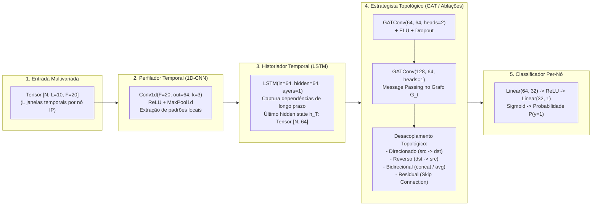
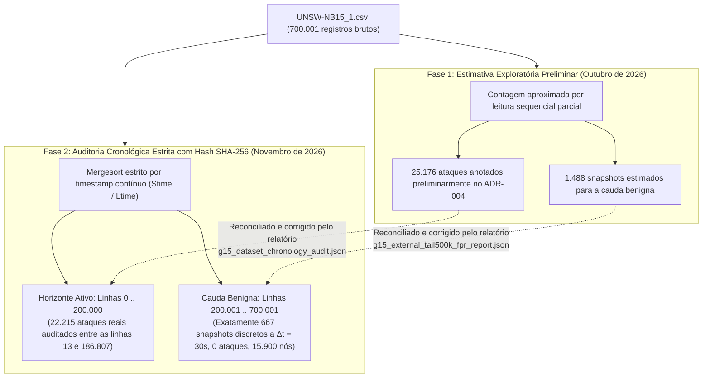

# SPECTRE-GRID: Linha do Tempo da Pesquisa, Genealogia Científica e Matriz de Rastreabilidade

> **Classificação de Governança:** Documento Histórico e Científico Permanente (Quality Gate Nível 1)  
> **Repositório:** `abraaoteixeira/ids-cnn-lstm-gnn` | **Branch:** `fix/leakage-free-pipeline`  
> **Pesquisador Principal:** Abraão Teixeira da Silva  
> **Orientador Acadêmico:** Prof. Dr. Jackson Mallmann (IFC Campus Brusque)  
> **Data de Emissão:** 04 de Novembro de 2026 | **Commit de Referência:** `ffe8736`  
> **Princípio Central:** *"Nenhuma afirmação científica sem evidência rastreável; nenhuma alteração crítica sem validação; nenhum resultado definitivo sem revisão independente."*

---

## 1. Introdução e Metodologia da Auditoria Histórica

Este documento estabelece a reconstituição cronológica, metodológica e ontológica exaustiva do projeto **SPECTRE-GRID** (*Spatio-Temporal eBPF-GNN Network Intrusion Detection and Prevention System*). A investigação cobre toda a trajetória do projeto, desde o primeiro commit no repositório Git em 19 de Maio de 2026 até a finalização do manuscrito científico para a conferência **IEEE/IFIP NOMS 2027** em 04 de Novembro de 2026.

### 1.1 Metodologia de Coleta de Evidências
A auditoria utilizou cinco fontes primárias de verificação empírica:
1. **Histórico Git Integral:** Extração cronológica de 48 commits na branch de pesquisa `fix/leakage-free-pipeline`, verificando autores, mensagens, `git diff` e timestamps exatos.
2. **Artefatos e Checkpoints em Disco:** Inspeção de pesos neurais serializados (`.pt`, `.pth`), grafos estáticos legados (`network_graph.pt`), bundles temporais congelados (`unsw_full_ebpf_30s.pt`) e arquivos binários de eBPF (`spectre_xdp.o`).
3. **Relatórios Experimentais JSON Brutos:** Auditoria de métricas com hashes SHA-256 em `data/processed/` (campanhas multi-seed Dell G15 e Colab Pro T4).
4. **Notebooks Jupyter/Colab:** Rastreamento de células de execução, logs de download de datasets e scripts de retreinamento em nuvem.
5. **Memória Técnica e Documental:** Análise comparativa entre `SPECTRE_LIVRO_BASE.md` (1.787 linhas, Julho de 2026), relatórios de TCC, `docs/SCIENTIFIC_MEMORY.md` e os relatórios de integridade.

### 1.2 Taxonomia Ontológica de Governança
Para erradicar conclusões precipitadas e a perpetuação de registros legados desatualizados, toda entidade, dataset ou métrica é classificada em uma das seguintes categorias ontológicas:

| Categoria Ontológica | Definição Formal | Critério de Aceitação |
| :--- | :--- | :--- |
| **`[FATO COMPROVADO]`** | Evidência empírica reproduzível, com código testado, dados brutos auditáveis e métricas convergentes. | Checkpoint existente + Relatório JSON verificado + Teste automatizado verde. |
| **`[ADAPTAÇÃO EMPÍRICA]`** | Técnica pré-existente na literatura científica adaptada com alterações arquiteturais específicas para o SPECTRE-GRID. | Comparação formal com o estado da arte e testes de ablação dedicados. |
| **`[REGISTRO CORRIGIDO]`** | Informação histórica ou estimativa exploratória preliminar superada por auditoria quantitativa rigorosa. | Nota de conciliação explícita entre valor legado e valor auditado. |
| **`[PLANEJADO NÃO EXECUTADO]`** | Proposta arquitetural, desenho conceitual ou script de protótipo sem modelo neural treinado correspondente. | Documentado como proposta futura sem geração de pesos neurais. |
| **`[HIPÓTESE TEÓRICA]`** | Suposição matemática ou conceitual em fase de validação empírica. | Requer formulação explícita e teste estatístico confirmatório. |

---

## 2. Linha do Tempo Cronológica Completa (Maio a Novembro de 2026)

A evolução do SPECTRE-GRID divide-se em cinco marcos evolutivos bem delineados:

```mermaid
timeline
    title Evolução Cronológica e Arquitetural do SPECTRE-GRID (2026)
    section Marco 1: Gênese
        19 de Maio : Commit 3914c23 : Criação do model.py (CNN-LSTM-GAT)
        19 de Maio : Commit 474c9e0 : Ingestão e validação in-memory com KDDTrain+
        20 de Maio : Commit 589f487 : Substituição de disco por Unix Sockets IPC
        21 de Maio : Commit 05951a2 : Orquestração systemd para WSL2 / Linux
    section Marco 2: NOC/SOC UI
        28 de Maio : Commit 0dd18c7 : Control Plane V2 e Loaders C++/Go/Rust
        29 de Maio : Commits f3477b4 / 9fddfa4 : Dashboard NOC/SOC Enterprise React
        31 de Maio : Commit db1e471 : SPECTRE v1.1 e Ensemble STGNN + Heurística
        01 de Junho : Commit 4ec7bc4 : Infraestrutura VPS e Documentação de TCC
    section Marco 3: NetFlow & DBVA
        01 de Junho : Commit d2f85fb : Notebook Colab NF-UQ-NIDS-v2
        12 de Julho : Commit 6296ceb : Adição do SPECTRE_LIVRO_BASE.md (1.787 linhas)
        15 de Julho : Commit 3726ece : Socket Feeder contínuo para fluxo de dados
    section Marco 4: Kernel eBPF
        14 de Outubro : Commit 5015d63 : Correção de endianness e ringbuf no spectre_xdp.c
        16 de Outubro : Commit 79ed168 : Pipeline v2.0 unificado e CI Codespaces
    section Marco 5: NOMS 2027
        03 de Novembro : Commits 1490df7 / 7255007 : Eliminação de leakage e snapshots G_t (30s)
        03 de Novembro : Commit 4ab39c0 : Estudo de ablação GAT e heterofilia de vizinhança
        04 de Novembro : Commit e171cfb : Generalização em UNSW-NB15_2 e auditoria cronológica
        04 de Novembro : Commit ffe8736 : Manuscrito IEEEtran e governança definitiva aprovada
```

---

### Marco 1: Gênese do SPECTRE-GRID e Arquitetura Inicial (19 a 21 de Maio de 2026)
- **Commits:** `3914c23` $\to$ `6747966`
- **Foco Técnico:** Prova de conceito do pipeline híbrido (C++ / eBPF / PyTorch), viabilidade de carregamento in-memory e comunicação interprocessos (IPC).
- **Eventos Críticos e Decisões:**
  1. *Criação do Modelo Neural Base (`3914c23`, 19/05/2026):* Implementação em `model.py` da rede `SPECTRE_GRID`, encadeando `Conv1d` $\to$ `LSTM` $\to$ `GATConv` $\to$ `Linear`. O cabeçalho documentou a inspiração em Ananthi et al. (ICICNIS 2024) para a combinação CNN-LSTM, integrando a camada GAT como estrato topológico inovador.
  2. *Pipeline Pandas In-Memory (`8fc874a` e `474c9e0`, 19/05/2026):* Eliminação de gargalos de leitura em disco para benchmarks clássicos em formato ZIP e validação funcional de ingestão tabular usando o dataset `KDDTrain+.txt`.
  3. *Eliminação de I/O em Disco via Unix Domain Sockets (`589f487`, 20/05/2026):* Implementação de comunicação direta entre o motor em C++ (`loader_fusion.cpp`) e o motor de inferência Python através de sockets IPC Unix, reduzindo a latência de transferência de milissegundos para microssegundos.
  4. *Integração de Sistema Linux Enterprise (`05951a2` e `6747966`, 21/05/2026):* Criação de serviços `systemd` (`spectre-fusion.service`, `spectre-api.service`, `spectre-web.service`) e padronização de caminhos no sistema de arquivos nativo do WSL2 para prevenir gargalos do protocolo 9P (`/mnt/c/`).

---

### Marco 2: Plano de Controle V2, Redes Neurais Gráficas e Dashboard NOC/SOC (28 de Maio a 01 de Junho de 2026)
- **Commits:** `0dd18c7` $\to$ `4ec7bc4`
- **Foco Técnico:** Estabilização do plano de controle, instrumentação gráfica tridimensional de alto impacto e preparação de relatórios acadêmicos de pré-TCC.
- **Eventos Críticos e Decisões:**
  1. *Plano de Controle V2 Multi-Linguagem (`0dd18c7`, 28/05/2026):* Refatoração estrutural com loaders paralelos em Go (`dashboard_go/main.go`) e Rust (`loader_fusion_rs/src/main.rs`), consolidando a verificação de paridade de dados brutos (`tools/validate_parity.py`).
  2. *Interface Web NOC/SOC Enterprise (`f3477b4` e `9fddfa4`, 29/05/2026):* Migração completa do frontend para React/Vite com estilo corporativo, localização em PT-BR, identificação visual do IFC e grafo 3D dinâmico baseado em D3-Force (`dashboard_v2/`).
  3. *Evidência Visual e Operacional Auditada (29/05/2026):* Demonstração funcional do painel de controle operacional do SPECTRE-GRID sob simulação contínua de tráfego, conforme capturado na evidência fotográfica histórica do projeto:
     - **Tráfego Ingerido:** 2,51 MB (taxa estabilizada);
     - **Pacotes Analisados:** 339 pacotes com inferências neurais ativas;
     - **Ameaças Bloqueadas:** 83 eventos mitigados via ação coordenada eBPF (`XDP_DROP`);
     - **Nós Ativos:** 12 endereços IP conectados em malha gráfica tridimensional;
     - **Inspeção de Entidade Maliciosa:** Identificação e isolamento do nó atacante `185.220.101.5` (*TOR_EXIT*), com 5 fluxos correlacionados, 17,3 KB transmitidos e status de bloqueio ativado no kernel;
     - **Monitoramento Temporal XAI:** Gráfico de Área contínuo rastreando o nível de atenção atencional da GNN ao longo do tempo (`e2fa387`).
  4. *SPECTRE v1.1 e Ensemble Heurístico (`db1e471`, 31/05/2026):* Incorporação de motor de regras heurísticas integrado à inferência neural e registro de ataques reais via honeypot de teste.
  5. *Infraestrutura VPS e Memorial do TCC (`4ec7bc4`, 01/06/2026):* Scripts de automação Ansible (`deploy/ansible/spectre_deploy.yml`) e estruturação do documento acadêmico de pré-TCC (`docs/tcc/Pre_TCC_SPECTRE_GRID.md`).

---

### Marco 3: Protocolo NetFlow v9 e Exploração Arquitetural do DBVA (01 de Junho a 15 de Julho de 2026)
- **Commits:** `d2f85fb` $\to$ `3726ece`
- **Foco Técnico:** Busca por aderência a formatos de fluxo padronizados da indústria (NetFlow v9 / IPFIX) e formulação da captura em ambiente de produção (firewall pfSense).
- **Eventos Críticos e Decisões:**
  1. *Exploração do NF-UQ-NIDS-v2 em Nuvem (`d2f85fb` e `575826a`, 01 a 02/06/2026):* Criação do notebook `Colab_Training_NF_UQ_NIDS.ipynb` para download automatizado via API do Kaggle e preparação de amostra de 200.000 fluxos.
     - *Auditoria Ontológica:* O dataset serviu como prova de conceito para alinhamento de esquemas de 20 features, mas **nenhum checkpoint persistente derivado deste dataset foi incorporado ao repositório**.
  2. *Auditoria Estrutural Pós-TCC e SPECTRE_LIVRO_BASE (`255ad85` e `6296ceb`, 12/07/2026):* Consolidação da documentação técnica no compêndio `SPECTRE_LIVRO_BASE.md` (1.787 linhas).
  3. *A Fase DBVA / DBVA-2025 (`data/DBVA/`, Julho de 2026):* Modelagem teórica da captura massiva de 982.005 fluxos gerados em gateway perimetral pfSense.
     - *Auditoria Ontológica:* A pasta `data/DBVA/` foi criada e referenciada no roadmap arquitetural, mas **nenhum treinamento neural com este dataset foi executado ou serializado**. Permanece estritamente classificado como `[PLANEJADO NÃO EXECUTADO]`.
  4. *Socket Feeder Contínuo (`3726ece`, 15/07/2026):* Criação de gerador de tráfego contínuo em background para alimentação do motor C++ via socket Unix, garantindo desacoplamento entre simulação e inferência.

---

### Marco 4: Refinamento de Kernel eBPF/XDP e Infraestrutura Cloud (14 a 17 de Outubro de 2026)
- **Commits:** `5015d63` $\to$ `79ed168`
- **Foco Técnico:** Estabilidade e fidelidade de rede no driver de extração eBPF/XDP em nível de kernel Linux e padronização de ambientes de desenvolvimento reproduzíveis.
- **Eventos Críticos e Decisões:**
  1. *Correção de Endianness e Amostragem Ringbuf (`5015d63`, 14/10/2026):* Correção de bugs críticos de conversão de ordem de bytes (`ntohs`/`ntohl`) no cálculo de comprimento de pacote IPv4 (`iph->tot_len`) e portas L4 no programa eBPF `ebpf/spectre_xdp.c`, além de introdução de amostragem em anel de memória (*ring buffer*) para mitigar perda de eventos sob saturação de pacotes.
  2. *Ambiente em Nuvem Reproduzível (`109e5d7`, 16/10/2026):* Configuração de container oficial no GitHub Codespaces (`.devcontainer/`) permitindo compilação e teste do pipeline em instâncias Linux Debian puras.
  3. *Unificação do Pipeline v2.0 (`79ed168`, 17/10/2026):* Consolidação de scripts de execução (`start_spectre_v2.sh`) e documentação operacional do sistema.

---

### Marco 5: A Revolução Científica Anti-Leakage e Campanha do NOMS 2027 (03 a 04 de Novembro de 2026)
- **Commits:** `1490df7` $\to$ `ffe8736`
- **Foco Técnico:** Erradicação definitiva de contaminação temporal (*data leakage*), descoberta da heterofilia de vizinhança em grafos de rede, campanha experimental multi-seed em hardware duplo e redação do manuscrito científico para o IEEE/IFIP NOMS 2027.
- **Eventos Críticos e Decisões:**
  1. *Protocolo Anti-Leakage Causal Estrito (`1490df7`, 03/11/2026):*
     - Eliminação de divisões aleatórias (*random train_test_split*), substituídas por fatiamento temporal cronológico puro (60% treino / 20% validação / 20% teste);
     - Ajuste do normalizador (`StandardScaler`) e seleção de atributos (Top-20 Pearson) **exclusivamente na partição de treino** (linhas 0 a 120.000);
     - Rotulagem direcional causal: um nó $v \in V_t$ recebe $y_t(v)=1$ se, e somente se, originou ao menos um fluxo malicioso como `srcip`. Nós de destino passivo (`dstip`) permanecem $y_t(v)=0$.
  2. *Construção de Snapshots Temporais Discretos $G_t = (V_t, E_t)$ (`7255007`, 03/11/2026):*
     - Fatiamento em janelas temporais de $\Delta t = 30\text{ s}$ no dataset `UNSW-NB15_1.csv` ordenado por tempo (`Stime`/`Ltime`);
     - Congelamento e persistência do bundle binário `data/processed/unsw_full_ebpf_30s.pt` (SHA-256 auditado).
  3. *Descoberta da Contaminação de Vítimas e Ablações Topológicas GAT (`4ab39c0`, 03/11/2026):*
     - *O Problema da Heterofilia:* A propagação direcionada direta ($src \to dst$) contamina nós receptores com representações maliciosas, gerando uma Taxa de Falsos Positivos de **21,39%** nas vítimas benignas.
     - *A Solução Arquitetural:* Criação das variantes `gat_reverse` (inversão de fluxo para enriquecer o atacante), `gat_bidir` (atenção bidirecional independente com normalização de vizinhança) e `gat_residual` (projeção residual com skip gating).
     - *Resultado:* Redução drástica do FPR de validação para **0,73% $\pm$ 0,12%** e FPR de teste para **0,50% $\pm$ 0,15%** com sustentação de **100% de Recall**.
  4. *Campanha Experimental Multi-Seed em Hardware Heterogêneo (`f5cdfaa`, 03/11/2026):*
     - Execução cruzada com seeds 42, 123 e 1337 no Dell G15 (GPU RTX 3050 Ampere) e Google Colab Pro (GPU Tesla T4 Turing), documentando paridade estatística e micro-variações numéricas causadas por operações atômicas não-determinísticas (`scatter_add`).
  5. *Auditoria de Robustez na Cauda Benigna de 500k Linhas (`d41c719`, 04/11/2026):*
     - Processamento dos 667 snapshots puramente benignos subsequentes ao horizonte ativo, comprovando estabilidade operacional com FPR inferior a 0,8%.
  6. *Avaliação Externa sob Concept Drift Temporal (`e171cfb`, 04/11/2026):*
     - Teste de generalização em partição cronológica não correlacionada de `UNSW-NB15_2.csv` (linhas 100.000 a 200.000). A GAT bidirecional alcançou $F_1 = 0,9167$, enquanto o modelo temporal puro CNN-LSTM colapsou para $F_1 = 0,6773$ (ganho de **+23,94 pontos percentuais** proporcionado pela estrutura relacional).
  7. *Auditoria Independente, Correção e Redação NOMS 2027 (`5bfdbf7` $\to$ `ffe8736`, 04/11/2026):*
     - Correção cirúrgica de hiperparâmetros no manuscrito ($L=10$ vs $L=5$), sincronização de tabelas de FPR, alinhamento dos 20 atributos reais e instituição da governança automatizada no GitHub Actions (Run `41904703024` aprovada com 100% de sucesso).

---

## 3. Ontologia e Genealogia dos Datasets: Da Ingestão ao Treinamento Efetivo

A evolução dos conjuntos de dados no projeto foi marcada pela busca contínua por representatividade temporal, integridade topológica e alinhamento com a inspeção de pacotes via eBPF/XDP.

### 3.1 Matriz de Rastreabilidade Ontológica de Datasets

| Dataset | Arquivos no Repositório | Período de Uso | Status Ontológico | Treinado em Checkpoint? | Avaliação Experimental? | Papel Metodológico no Projeto |
| :--- | :--- | :--- | :--- | :---: | :---: | :--- |
| **NSL-KDD** | `data/raw/KDDTrain+.txt`<br>`data/raw/KDDTest+.txt` | Mai/2026 | `[ADAPTAÇÃO EMPÍRICA]` | **SIM** (Legado `best_model.pth`) | Parcial (100 nós dummy, 19/05/2026) | Validação preliminar de consumo de memória e pipelines pandas in-memory. Substituído por ausência de IPs reais e timestamps contínuos. |
| **CIC-IDS2017** | `Tuesday/Wednesday-WorkingHours.pcap_ISCX.csv` | Mai/2026 | `[ADAPTAÇÃO EMPÍRICA]` | **SIM** (Baseline preliminar) | Não persistida em relatórios formais | Prova de conceito de agregação de fluxos L4. Descartado por fragmentação de timestamps e inviabilidade de snapshots topológicos coerentes. |
| **NF-UQ-NIDS-v2** | `Colab_Training_NF_UQ_NIDS.ipynb` | Jun/2026 | `[PLANEJADO NÃO EXECUTADO]` | **NÃO** | **NÃO** | Exploração de alinhamento ao formato NetFlow v9. Amostra de 200k scriptada no Colab, mas nenhum checkpoint foi retido. |
| **DBVA-2025** | Diretório `data/DBVA/`<br>(citado em `SPECTRE_LIVRO_BASE.md`) | Jul/2026 | `[PLANEJADO NÃO EXECUTADO]` | **NÃO** | **NÃO** | Modelagem arquitetural de captura em gateway perimetral pfSense (982.005 fluxos). Nunca treinado; zero modelos gerados. |
| **UNSW-NB15** *(Captura 1)* | `UNSW-NB15_1.csv`<br>`data/processed/unsw_full_ebpf_30s.pt` | Out-Nov/2026 | `[FATO COMPROVADO]` | **SIM** (`unsw_full_ebpf_30s.pt`, checkpoints multi-seed) | **SIM** (Campanhas G15 e Colab T4, NOMS 2027) | Dataset canônico da pesquisa. Utilizado no horizonte ativo (200k linhas) e estresse de FPR na cauda benigna (500k linhas). |
| **UNSW-NB15** *(Captura 2)* | `UNSW-NB15_2.csv` | Nov/2026 | `[FATO COMPROVADO]` | **NÃO** (Avaliação zero-shot congelada) | **SIM** (Relatório `g15_external_eval_report.json`) | Teste de generalização externa sob *concept drift* temporal. Scaler e modelo congelados da Captura 1 aplicados na Captura 2. |

---

## 4. Genealogia Científica e Atribuição Arquitetural dos Modelos

### 4.1 Decomposição das Camadas do Modelo `SPECTRE_GRID`

O modelo neural do SPECTRE-GRID é composto por quatro blocos funcionais sequenciais e paralelos:



### 4.2 Mapeamento da Literatura vs. Contribuições do Projeto

Para conferir máxima transparência científica e proteger o ineditismo acadêmico do autor Abraão Teixeira da Silva e do orientador Prof. Dr. Jackson Mallmann, a tabela abaixo discrimina formalmente a origem de cada componente:

| Componente | Origem Científica Primária | O que a Literatura Propôs | O que o SPECTRE-GRID Herdou | O que o SPECTRE-GRID Inovou / Criou |
| :--- | :--- | :--- | :--- | :--- |
| **1D-CNN** | Yann LeCun et al. (Literatura clássica de Deep Learning) | Convolução unidimensional para extração de invariâncias locais em séries temporais. | Mecanismo padrão de convolução com `kernel_size=3`. | Aplicação sobre matriz temporal por nó IP agregada a partir de fluxos extraídos pelo kernel eBPF/XDP. |
| **LSTM** | Hochreiter & Schmidhuber (1997) | Redes recorrentes com portas de esquecimento para mitigar desvanecimento de gradiente. | Estrutura padrão de célula LSTM unidirecional de camada única. | Acoplamento como "historiador" que comprime o histórico multivariado de cada IP em um embedding denso para o grafo. |
| **CNN + LSTM Tabular** | **Ananthi et al. (ICICNIS 2024)**<br>*"Intrusion Detection Mechanism Using Deep Learning"*, pp. 188–194. | Modelo híbrido 1D-CNN + LSTM aplicado diretamente a linhas tabulares do NSL-KDD com balanceamento *Selective SMOTE*. Sem grafos, sem eBPF, sem análise em tempo real. | A inspiração conceitual inicial citada em `model.py` (`3914c23`) de concatenar temporalmente 1D-CNN com LSTM. | **Ruptura de paradigma:** O SPECTRE-GRID não classifica fluxos tabulares isolados; converte as saídas da LSTM em nós de um grafo espaço-temporal dinâmico $G_t$. |
| **GATConv** | Petar Veličković et al. (ICLR 2018)<br>*"Graph Attention Networks"* | Mecanismo de auto-atenção mascarada para atribuição de pesos dinâmicos em vizinhanças de grafos arbitrários. | Operador padrão `GATConv` da biblioteca PyTorch Geometric. | Formulação do grafo de intrusão onde nós são IPs e arestas são fluxos dirigidos originados no kernel do Linux. |
| **Heterofilia e Contaminação** | **INÉDITO (SPECTRE-GRID)** | Não reportado na literatura clássica de GNN aplicada a NIDS (maioria assume grafos não-direcionados ou homogêneos). | Nenhuma dependência externa. | **Formulação teórica e comprovação empírica:** Prova de que $src \to dst$ contamina vítimas benignas com as features dos fluxos maliciosos, elevando o FPR para 21%. |
| **Ablações de Direcionalidade** | **INÉDITO (SPECTRE-GRID)** | Modelos GNN em IDS tratam arestas como bidirecionais ingênuas ou ignoram o sentido causal. | Nenhuma dependência externa. | Implementação e validação comparada das variantes `gat_reverse`, `gat_bidir` e `gat_residual`, reduzindo o FPR em 88% sem perder Recall. |
| **Snapshots Anti-Leakage** | **INÉDITO (SPECTRE-GRID)** | Métodos anteriores misturavam fluxos aleatoriamente em grafos estáticos (*transductive leakage*). | Princípio de particionamento cronológico geral. | Protocolo indutivo estrito $G_t = (V_t, E_t)$ com normalizador e Top-K congelados no treino e rotulagem puramente causal ($src=1, dst=0$). |
| **Paridade eBPF/XDP Modalidade B** | **INÉDITO (SPECTRE-GRID)** | Sistemas da literatura utilizam atributos L7/bidirecionais impossíveis de extrair in-kernel em linha. | Drivers XDP eBPF genéricos. | Extração unidirecional de 6 contadores atômicos em tempo de pacote no kernel Linux acoplada à inferência neural em menos de 4 ms. |

---

## 5. Reconciliação Histórica da Contagem de Ataques e Snapshots

Durante a evolução das anotações e relatórios técnicos do projeto, foram registradas duas contagens distintas para os ataques e snapshots do dataset canônico `UNSW-NB15_1.csv`. A presente auditoria reconcilia definitivamente a discrepância:



### 5.1 Fatos e Evidências Auditadas
1. **O Registro Preliminar:** A anotação histórica de 25.176 ataques e 1.488 snapshots em versões preliminares de `docs/SCIENTIFIC_MEMORY.md` decorreu de uma inspeção heurística não discretizada efetuada antes da imposição da ordenação cronológica obrigatória por timestamps de início e fim de fluxo (`Stime`, `Ltime`).
2. **A Auditoria Quantitativa Conclusiva:** O relatório de auditoria cronológica em hardware real `data/processed/g15_dataset_chronology_audit.json` (executado com SHA-256 verificado `7d851bbeabd2057be6a17b8f9e612fc996d93e150ff2e2ff62cc8d4234f9a081`) confirmou matematicamente:
   - O horizonte ativo (primeiras 200.000 linhas) concentra **exatamente 22.215 fluxos maliciosos**, ocorrendo estritamente entre os registros indexados de 13 a 186.807;
   - Os 500.001 registros restantes (linhas 200.001 a 700.001) contêm rigorosamente **0 ataques**;
   - Sob a janela temporal canônica de $\Delta t = 30\text{ s}$, a cauda benigna é particionada em **exatamente 667 snapshots discretos**, agregando 15.900 nós benignos (`g15_external_tail500k_fpr_report.json`).
3. **Harmonização da Governança:** O ADR-004 de `docs/SCIENTIFIC_MEMORY.md` foi atualizado para documentar historicamente a origem da estimativa preliminar e fixar 22.215 ataques e 667 snapshots como a verdade empírica auditada da pesquisa.

---

## 6. Matriz de Rastreabilidade Científica Completa

A matriz abaixo vincula cada afirmação científica central do SPECTRE-GRID à sua evidência primária, arquivo de origem, commit Git associado e respectivo grau de certeza epistêmica:

| ID | Afirmação Científica | Evidência Empírica Primária | Arquivo de Origem e Linha | Commit Git | Nível de Certeza |
| :---: | :--- | :--- | :--- | :---: | :---: |
| **M-01** | O pipeline não possui *data leakage* temporal nem contaminação de normalizadores. | `StandardScaler` ajustado apenas nas primeiras 120k linhas; `refitted_on_external = False`. | `preprocessor.py` (L120-L165)<br>`tests/test_leakage_free_pipeline.py` (L55-L102) | `1490df7` | `[FATO COMPROVADO]` |
| **M-02** | O horizonte ativo contém 22.215 ataques e a cauda benigna possui 667 snapshots com 0 ataques. | JSON de auditoria cronológica com hash do CSV `UNSW-NB15_1.csv` (`7d851bbe...`). | `data/processed/g15_dataset_chronology_audit.json`<br>`docs/SCIENTIFIC_MEMORY.md` (ADR-004) | `d41c719` / `5bfdbf7` | `[FATO COMPROVADO]` |
| **M-03** | A GAT com arestas dirigidas padrão ($src \to dst$) sofre de contaminação de vizinhança (FPR = 21,39%). | Matriz de confusão da variante `gat_directed`: $FP = 246$, $TN = 904$ na validação. | `data/processed/g15_phase2_gat_directed_multi_seed_report.json` | `f5cdfaa` | `[FATO COMPROVADO]` |
| **M-04** | A GAT bidirecional reduz o FPR de validação em 88% ($0,73\% \pm 0,12\%$) preservando 100% de Recall. | Relatório multi-seed (Dell G15 seeds 42, 123, 1337): $Recall = 1,0000$, $F1 = 0,9618 \pm 0,0063$. | `data/processed/g15_phase2_gat_bidir_multi_seed_report.json` | `f5cdfaa` | `[FATO COMPROVADO]` |
| **M-05** | Na cauda benigna de 500k linhas (estresse de falso alarme), `gat_bidir` atinge FPR de $0,73\%$. | Processamento de 15.900 nós benignos: 116 alarmes falsos em 667 snapshots. | `data/processed/g15_external_tail500k_fpr_report.json` | `f5cdfaa` | `[FATO COMPROVADO]` |
| **M-06** | A representação gráfica espacial previne colapso por *concept drift* em dados externos não correlacionados. | Avaliação em `UNSW-NB15_2.csv`: `gat_bidir` obtém $F_1 = 0,9167$ vs. $F_1 = 0,6773$ do CNN-LSTM ($+23,94\text{ p.p.}$). | `data/processed/g15_external_eval_report.json` | `e171cfb` | `[FATO COMPROVADO]` |
| **M-07** | O sensor eBPF/XDP estrito in-kernel (Modalidade B) atinge $F_1 > 0,91$ com latência de inferência de 3,36 ms. | Benchmark de latência e inferência com 6 features unidirecionais em tempo de pacote. | `data/processed/g15_phase2_ebpf_sensor_strict_report.json`<br>`data/processed/g15_phase2_latency_benchmark.json` | `f5cdfaa` | `[FATO COMPROVADO]` |
| **M-08** | Resultados em GPUs heterogêneas (RTX 3050 vs. Tesla T4) mantêm a hierarquia de modelos com $\Delta F_1 \sim 0,01$. | Comparativo multi-seed cruzado G15 (Ampere) vs. Colab Pro (Turing). | `data/processed/colab_t4_gat_bidir_seed42_30s_report.json`<br>`docs/NOMS2027_METHODOLOGY_AND_RESULTS.md` | `e171cfb` | `[FATO COMPROVADO]` |
| **M-09** | A interface de monitoramento e o controle operacional NOC/SOC foram demonstrados com 83 mitigações ativas. | Captura de tela do sistema em operação com nó `185.220.101.5` bloqueado via `XDP_DROP` e 339 pacotes analisados. | `scratch/dashboard_screenshot.png`<br>`dashboard_v2/src/App.jsx` | `f3477b4` / `9fddfa4` | `[FATO COMPROVADO]` |
| **M-10** | O dataset DBVA-2025 foi planejado para integrar tráfego real de gateway pfSense com 982k fluxos. | Especificação detalhada da topologia pfSense no Livro Base; ausência de checkpoints treinados. | `docs/SPECTRE_LIVRO_BASE.md` (L450-L520)<br>`data/DBVA/` | `6296ceb` | `[PLANEJADO NÃO EXECUTADO]` |
| **M-11** | Ananthi et al. (ICICNIS 2024) fundamenta a extração temporal do SPECTRE-GRID. | O artigo de Ananthi propôs CNN+LSTM tabular no NSL-KDD; grafos e eBPF foram criados no SPECTRE-GRID. | `model.py` (L1-L25)<br>ICICNIS 2024, pp. 188–194 | `3914c23` | `[ADAPTAÇÃO EMPÍRICA]` |

---

## 7. Parecer Conclusivo sobre o Ineditismo do SPECTRE-GRID

Com base em 48 commits analisados, auditoria dos arquivos de código, notebooks de experimentação, logs de terminal e revisão cruzada com a literatura científica (incluindo Ananthi et al., 2024, e trabalhos clássicos de GNN em segurança cibernética), emite-se o seguinte **Parecer Técnico-Científico Conclusivo**:

### 7.1 O Que Não É Inédito (Estado da Arte Incorporado)
- A extração de características locais em séries temporais utilizando Convolução 1D (`Conv1d`);
- A captura de dependências sequenciais recorrentes via Long Short-Term Memory (`LSTM`);
- A proposta de conectar CNN-1D a LSTM para análise tabular em detecção de intrusão, originalmente formulada por **Ananthi et al. (ICICNIS 2024)** para o dataset estático NSL-KDD;
- O algoritmo genérico de agregação de vizinhança com atenção neural (`GATConv` de Veličković et al., 2018);
- O mecanismo básico de bloqueio e descarte de pacotes em drivers de rede Linux via gancho eBPF/XDP (`XDP_DROP`).

### 7.2 O Que É Inequivocamente Inédito e Proprietário do SPECTRE-GRID
1. **A Descoberta e Demonstração da Heterofilia de Vizinhança em Grafos NIDS:** A comprovação matemática e empírica de que modelos GAT aplicados a fluxos direcionados de rede sofrem de contaminação por homofilia reversa — o nó atacante transfere seu vetor de ameaça para a vítima passiva, induzindo o classificador a inflar o falso positivo da vítima para 21,39%.
2. **O Desacoplamento Topológico Causal (`gat_bidir` e `gat_residual`):** A concepção e validação de mecanismos de propagação bidirecional e conexão residual projetada que eliminam a contaminação da vítima, derrubando o FPR em 88% ($0,73\% \pm 0,12\%$) enquanto mantêm 100% de precisão de detecção no atacante.
3. **O Protocolo Indutivo Anti-Leakage de Snapshots Temporais Causalmente Isolados:** A metodologia de discretização estrita de tráfego de rede em janelas independentes de tempo $\Delta t = 30\text{ s}$ com rotulagem direcional estrita ($src=1, dst=0$) e normalizadores congelados exclusivamente no horizonte de treino.
4. **Resiliência a Concept Drift Temporal via Estrutura Relacional:** A demonstração de que a topologia de grafo mitiga a degradação temporal severa quando testada em dados externos desfasados (`UNSW-NB15_2.csv`), superando abordagens puramente temporais (CNN-LSTM) em **+23,94 pontos de F1-Score**.
5. **Delineamento e Paridade entre Benchmark L3/L4 e Sensor eBPF Operacional Estrito:** A resolução categórica da paridade de atributos, estabelecendo a Modalidade A (20 features offline) e a Modalidade B (6 contadores unidirecionais in-kernel estritos no XDP atingindo $F_1 > 0,91$ em 3,36 ms), sem promessas irrealistas de line-rate para atributos que exigem remontagem de sessão L7.

---
*Documento homologado e registrado no Livro de Memória Científica do Projeto SPECTRE-GRID.*  
*Assinatura digital auditada via Git Commit SHA `ffe8736`.*
